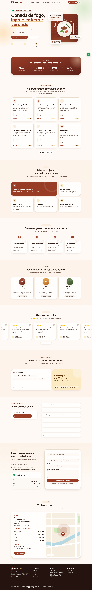

# Odonto Aurora — landing page de clínica odontológica

> **Projeto fictício para portfólio.** A clínica, os profissionais, os CROs, os convênios e os depoimentos são inventados.

Landing page moderna, rápida e acessível para uma clínica odontológica fictícia em Campinas – SP. Feita para parecer
um site real de agência: tipografia caprichada, paleta "saúde premium", animações sutis com Motion e agendamento que
termina direto no WhatsApp — **sem backend, sem banco e sem variáveis de ambiente**.

**Demo:** (link)

> 🔀 **Branches:** esta (`clinica`) é a versão clínica odontológica. O `main` traz o mesmo template trocado para um
> restaurante fictício (Alecrim & Brasa) — só `site.ts`, paleta, ilustração e logo mudam.

| Desktop (1440px) | Mobile (375px) |
| --- | --- |
|  |  |

> 🎨 Veja a [revisão de design com antes/depois](docs/revisao-design.md) (10 pontos de visual/UX corrigidos).

## Stack

- **Next.js 16** (App Router, Server Components por padrão, Cache Components) + **TypeScript** estrito
- **Tailwind CSS 4** + **shadcn/ui** (Radix) com tokens de tema próprios
- **Motion** (`motion/react`, com `LazyMotion`) para animações
- **lucide-react** para ícones · **next/font** com Plus Jakarta Sans (títulos) e Inter (texto)
- **react-hook-form** + **zod** no formulário · **sonner** para notificações
- **Playwright** + **axe** (testes E2E e de acessibilidade), **Lighthouse CI** e **GitHub Actions**
- **puppeteer-core** (dev) para os screenshots

## Funcionalidades

- **Conteúdo 100% centralizado** em [`src/config/site.ts`](src/config/site.ts) (tipado) — troque o arquivo e tenha outro negócio
- Header fixo com blur ao rolar, menu mobile (Sheet) acessível e destaque da seção ativa
- **Modo escuro** (claro/escuro/sistema, sem "piscar") com paleta própria em tokens — prints em
  [`docs/screenshots/desktop-dark.png`](docs/screenshots/desktop-dark.png) e [`mobile-dark.png`](docs/screenshots/mobile-dark.png)
- Hero com composição em SVG/gradientes (sem fotos) e animação de entrada em CSS (não atrasa o LCP)
- Contadores animados ao entrar na tela, cards com hover animado, bento grid, timeline que "preenche" com a rolagem
- Equipe com avatares de iniciais (aceita foto opcional via `next/image`)
- Depoimentos em marquee com pausa (hover, foco e botão) e fallback estático para "reduzir movimento"
- FAQ com Accordion, convênios em chips, "parcelamos em até 12x"
- **Página para cada tratamento** (`/tratamentos/<slug>`) com descrição longa, o que está incluso, FAQ próprio, "outros
  tratamentos", metadata e JSON-LD (`MedicalProcedure` + `BreadcrumbList` + `FAQPage`), geradas a partir do `site.ts`
- **Política de privacidade (LGPD)** em `/privacidade`, com link no rodapé e no formulário (inclui dados de saúde).
  Sem aviso de cookies porque o site não usa cookies nem rastreamento (só a preferência de tema fica no `localStorage`)
- **Agendamento**: formulário com máscara de WhatsApp, Select de tratamento, período e validação zod → abre o
  `wa.me` com a mensagem pronta + toast de sucesso
- Localização com mapa ilustrativo em SVG e botão "Como chegar" (Google Maps, sem iframe)
- Botão flutuante do WhatsApp
- **SEO**: metadata completa, Open Graph/Twitter gerados com `next/og`, ícones, `sitemap.xml`, `robots.txt`,
  manifest e JSON-LD `Dentist` (schema.org) gerado do `site.ts`
- **Acessibilidade**: HTML semântico, skip link, foco visível, rótulos ARIA, contraste AA e `MotionConfig reducedMotion="user"`

### Lighthouse (build de produção, local)

| | Performance | Acessibilidade | Boas práticas | SEO |
| --- | --- | --- | --- | --- |
| Mobile | 93–96 | 100 | 100 | 100 |
| Desktop | 100 | 100 | 100 | 100 |

## Como rodar

Requer **Node 22** e npm.

```bash
npm install
npm run dev          # http://localhost:3000
```

Outros comandos:

```bash
npm run lint         # ESLint
npm run build        # build de produção
npm run start        # serve o build de produção
npm run screenshots  # (com o start rodando) gera docs/screenshots/{mobile,desktop}.png
npm run test:e2e     # (depois do build) testes E2E: formulário, menu, âncoras, overflow, acessibilidade, SEO
npm run lhci         # (depois do build) Lighthouse CI mobile e desktop com notas mínimas
```

Os scripts com puppeteer usam o Chrome da máquina: defina `CHROME_PATH` (padrão `/usr/bin/google-chrome`).

## Como trocar o conteúdo (`site.ts`)

Todo texto, número, serviço, depoimento, contato e link está em **`src/config/site.ts`**, tipado por
`src/config/types.ts`. Os componentes **não têm texto do negócio no JSX** — só leem esse objeto.

Para transformar o site em um restaurante, pet shop, estúdio etc.:

1. Edite `brand`, `seo`, `contact`, `address`, `openingHours` e `social`.
2. Troque `brand.schemaType` pelo tipo schema.org do negócio (`Restaurant`, `PetStore`, `BeautySalon`…).
3. Reescreva as seções (`hero`, `stats`, `treatments`, `differentials`, `steps`, `team`, `testimonials`,
   `payment`, `faq`, `booking`, `location`, `footer`). O nome dos campos é genérico o bastante para serviços em geral
   (ex.: `treatments` vira o cardápio/serviços).
4. Ícones são referenciados por nome (`icon: "sparkles"`). A lista fica em [`src/lib/icons.ts`](src/lib/icons.ts) —
   para usar outro ícone do lucide, importe e adicione ao mapa.
5. A mensagem enviada ao WhatsApp é montada por `booking.form.buildMessage`, e as opções do formulário vêm de
   `booking.form.treatment.options` e `booking.form.period.options`.
6. Atualize `author` com seu nome e link (aparece no rodapé: "Projeto fictício desenvolvido para portfólio por …").
7. Cores: ajuste os tokens em `src/app/globals.css` (`--primary`, `--accent`, `--warm`, `--primary-deep`, `--footer`,
   `--illus-*`…) e as cores em hex de `site.theme` (imagem Open Graph, favicon e manifest).
8. Visual do hero e logo: `hero.visual.illustration` escolhe uma ilustração de
   [`src/components/illustrations`](src/components/illustrations/index.tsx) e `brand.logo.glyph` é o desenho do logo
   (path SVG em 40×40).
9. Fotos reais (opcionais): veja [`public/images/README.md`](public/images/README.md).

## Deploy na Vercel

1. Suba o repositório no GitHub.
2. Em [vercel.com/new](https://vercel.com/new), importe o repositório — o framework Next.js é detectado sozinho.
3. Clique em **Deploy**. Não há variáveis de ambiente, banco ou serviço externo para configurar.
4. Depois do primeiro deploy, atualize `url` em `src/config/site.ts` com o domínio final (usado em SEO, sitemap e
   Open Graph) e faça um novo push.

## Estrutura

```
src/
  app/                 layout, página, metadata, OG image, sitemap, robots, manifest
  config/              site.ts (conteúdo) e types.ts (tipos)
  components/
    sections/          uma seção por arquivo (hero, treatments, booking…)
    layout/            header, footer, botão do WhatsApp
    motion/            Reveal/Stagger/HoverCard (animações reutilizáveis)
    ui/                componentes do shadcn/ui
  lib/                 ícones, links (wa.me/Maps), máscara de telefone, JSON-LD
scripts/               screenshots (puppeteer-core)
tests/e2e/             testes Playwright (rodam no CI a cada PR)
.github/workflows/     CI: lint, build, E2E e Lighthouse
docs/screenshots/      prints usados neste README
```

---

Projeto fictício desenvolvido para portfólio por [Vitor Valentim Silva](https://github.com/vitorvalentimsilva).
