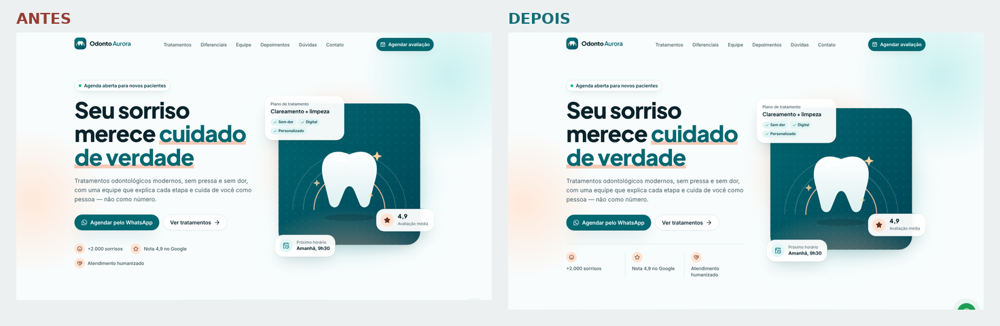
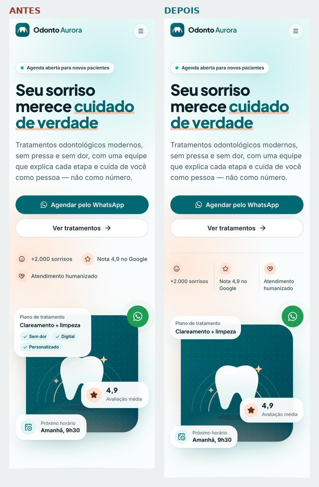
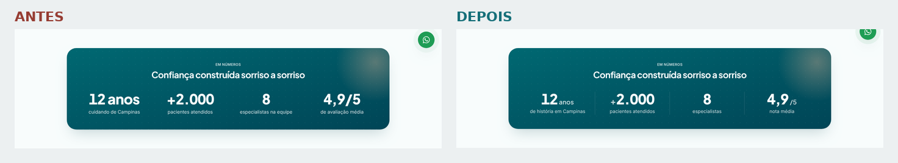
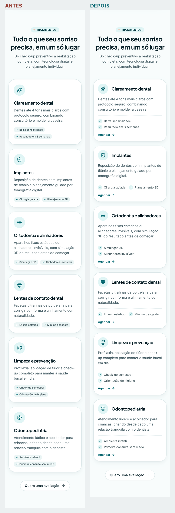
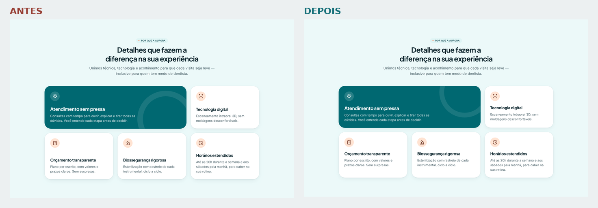
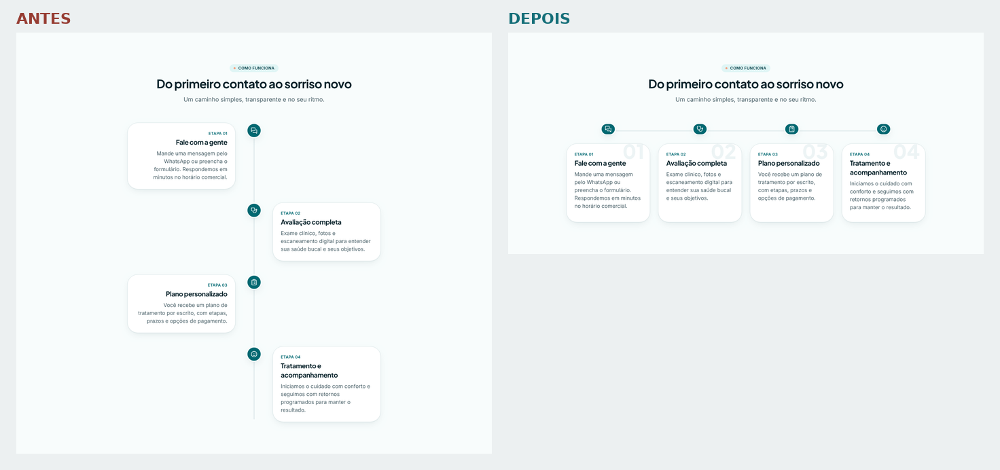
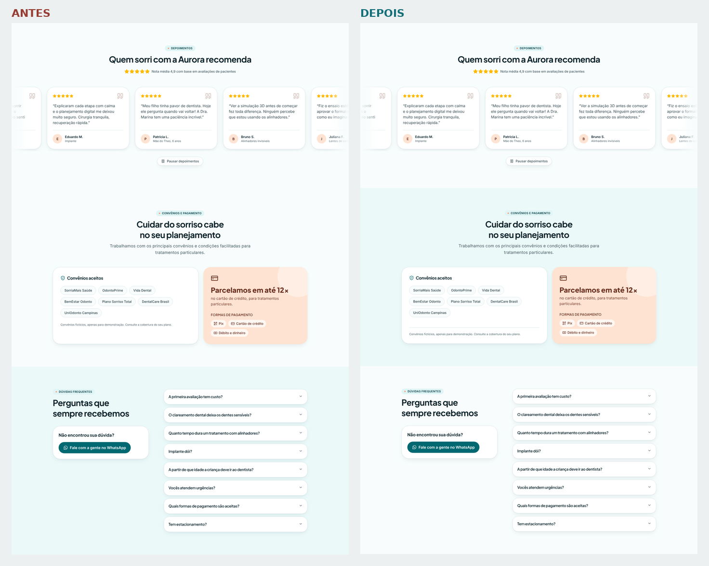
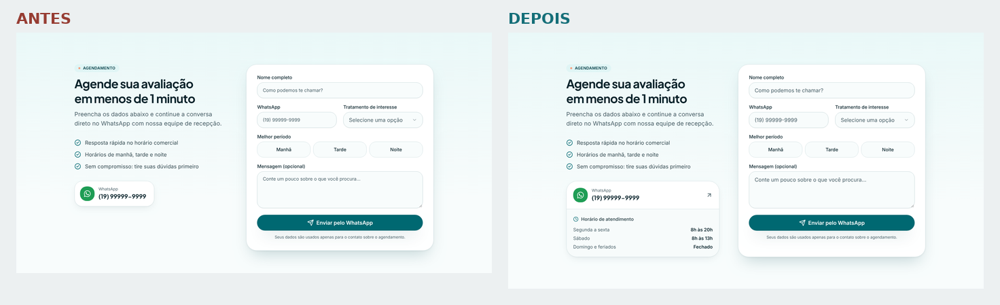

# Revisão de design — 10 pontos corrigidos

Revisão crítica do site inteiro (desktop 1440px e mobile 375px), com os 10 pontos mais fracos de visual/UX e o que
mudou em cada um. Os comparativos lado a lado estão em [`docs/revisao-design/`](revisao-design/).

| # | Onde | Problema (antes) | Correção (depois) |
| --- | --- | --- | --- |
| 1 | Hero (desktop) | Selos de confiança quebravam em 2 linhas desalinhadas e a coluna terminava "solta". | Faixa de selos em 3 colunas com divisores e linha de base, fechando a composição. |
| 2 | Hero (mobile) | Cartões flutuantes cobriam o dente e se sobrepunham. | Cartões menores, chips escondidos no celular e posições redistribuídas. |
| 3 | Números | Sufixos ("anos", "/5") com o mesmo peso do número; rótulos longos quebrando linha. | Sufixo menor e mais leve, divisores entre itens no desktop e rótulos curtos. |
| 4 | Tratamentos | Chips quebravam de forma irregular, cards altos no mobile e nenhuma ação no card. | Ícone ao lado do título no mobile, destaques em lista com check e link "Agendar" em cada card. |
| 5 | Diferenciais (bento) | Anel decorativo passava por trás do texto; conteúdo "empurrado" para baixo. | Decoração no canto superior e conteúdo alinhado ao topo em todos os cards. |
| 6 | Como funciona | Timeline estreita no desktop (muito vazio) e texto alinhado à direita, ruim de ler. | Timeline horizontal de 4 colunas no desktop (seção ~50% mais curta), texto sempre à esquerda e número da etapa em marca d'água. |
| 7 | Ritmo das seções | Depoimentos e Convênios tinham o mesmo fundo branco, quebrando a alternância. | Fundos alternados de novo (Convênios tingido, Dúvidas branco). |
| 8 | Convênios | Card de convênios com sobra no rodapé e alturas desequilibradas. | Card em coluna flexível com a nota fixada no rodapé, separada por linha. |
| 9 | Agendamento | Placeholders com tamanhos diferentes (Input menor que Select no desktop) e coluna esquerda vazia. | Tipografia uniforme nos campos e cartão de WhatsApp + horários de atendimento à esquerda. |
| 10 | Header | Nenhuma indicação de onde o usuário está na página. | Scrollspy: item da seção atual sublinhado e com `aria-current` (desktop e menu mobile). |

## Comparativos

